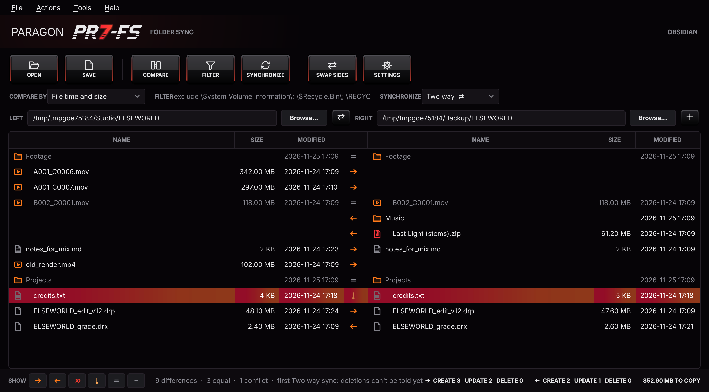
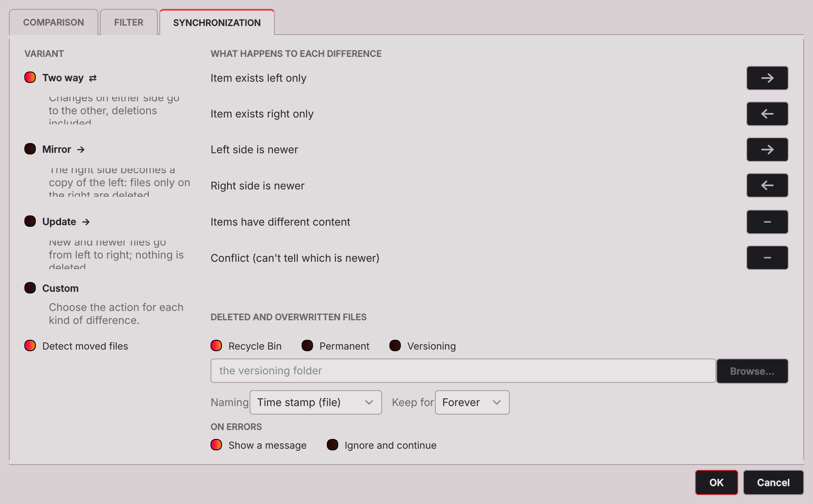

# Paragon PR7-FS

Folder comparison and sync that works the way **FreeFileSync** works, in the Paragon family look (PR7-Z, PR7-W, PR7-L,
PR7-F, PR7-E, PR7-R, PR7-P, PR7-M, PR7-Q, PR7-U, PR7-DU, PR7-CB, PR7-IS, PR7-PM, PR7-SM, PR7-HB). Python and PySide6.

## What it does

- **Compare** (F5) one or more folder pairs, by file time and size, by content (byte for byte) or by size. Both sides
  are scanned at once.
- Every difference shows what **Synchronize** (F9) will do with it: copy to the right or left, delete on one side, or
  nothing. Click the middle column to change it. A folder's contents follow it.
- **Variants**:
  - **Two way** keeps both sides alike, deletions included. A small record of the last sync, `.pr7fs.db` in both
    folders, tells a deleted file from a new one, and a file changed on both sides is a conflict that nothing
    overwrites. *Detect moved files* renames instead of copying again.
  - **Mirror** makes the right a copy of the left.
  - **Update** copies new and newer files to the right only.
  - **Custom** lets you choose per kind of difference.
- **Filter**: FreeFileSync's include / exclude patterns (`*.tmp`, `\.cache\`, `*\.git\`); **Exclude via Filter** on
  any row.
- Deleted and overwritten files go to the **Recycle Bin**, away for good, or into a **versioning** folder (time
  stamp per file or per folder, or replace), kept for as long as you choose.
- Safe copies: each file is written under a temporary name and put in place only when complete. File times are
  copied exactly.
- The sync window shows progress, speed graph, time left and a log. You can pause, stop or choose **When finished**.
  Errors ask Retry / Ignore / Ignore all / Cancel, or are skipped by setting.
- **Save** a setup as a `.pr7fs` file (double-click opens it). `PR7-FS.exe --batch job.pr7fs` synchronizes with no
  window, for Windows' Task Scheduler (exit code 0 done, 1 with errors, 2 failed).

## Building

`pip install -r requirements.txt -r requirements-dev.txt`, `python -m pytest`, `pyinstaller pr7fs.spec`, then Inno Setup:
`iscc /DAppVersion=x.y.z installer\pr7fs.iss`.
